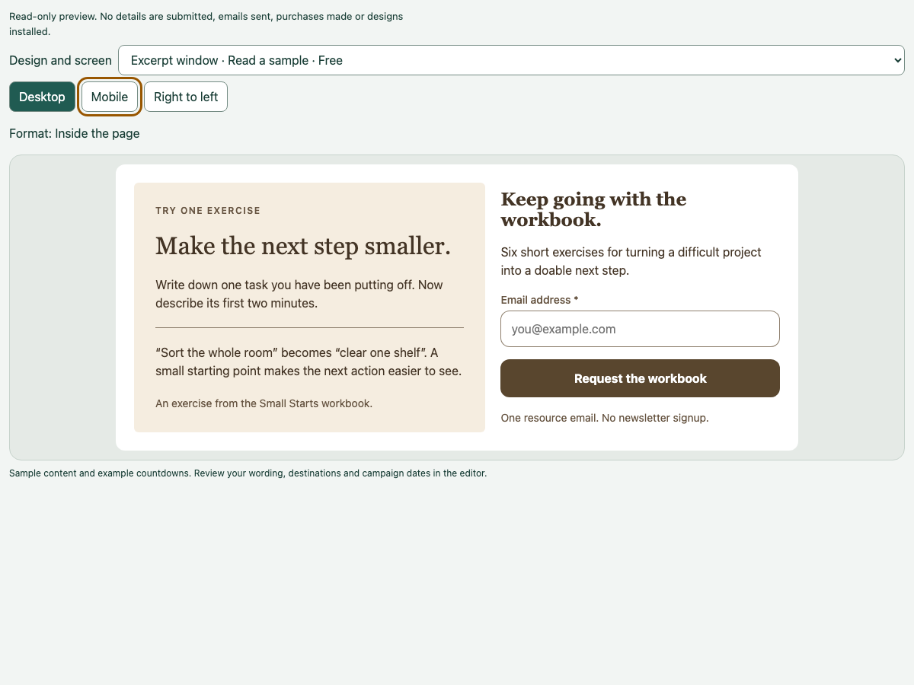
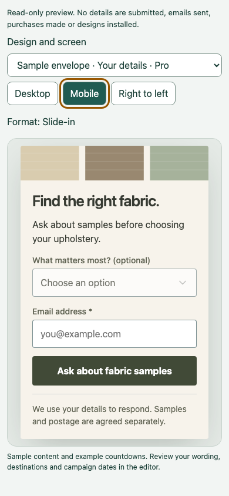
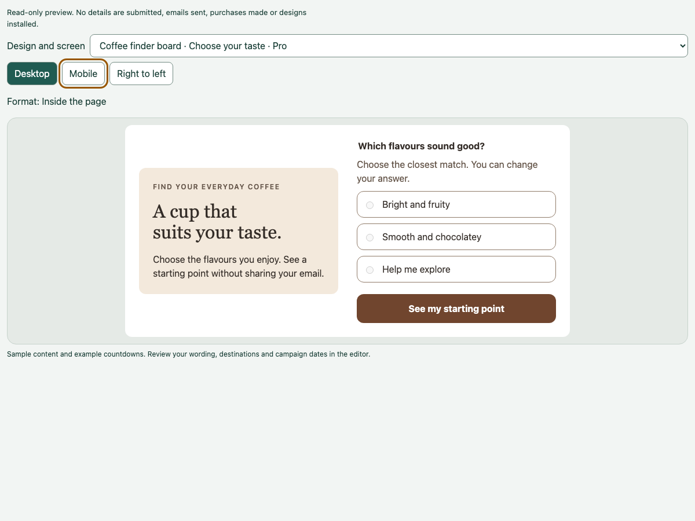

# Template gallery acceptance — 20 October 2026

Implemented and tested locally. No production deployment, remote publication or website modification was performed.

## Review

Local public-only Worker is running on `http://127.0.0.1:9464`. These links work while that process is running:

- [Excerpt window (Free)](http://127.0.0.1:9464/previews/a6c97f887f1f7e5aee57be8a609cf57512b7cac099c153a26c4d96fbffe0388d.html)
- [Sample envelope (Pro)](http://127.0.0.1:9464/previews/42928413b4643e746d01067877617d9f15dea9cefad9e393d002cc597af1186d.html)
- [Complete public catalogue](http://127.0.0.1:9464/releases/0e93e15299085eb7708218a13cf5963745ca6d7d8c036cf257c7ea2959175a98/designs.json)

[Public contract and website handoff](../../../tools/template-server/GALLERY-CONTRACT.md). [Actual example response](catalogue-example.json). The example response uses the intended production origin, but its new URLs are not deployed. For local viewing, replace only the origin with `http://127.0.0.1:9464`.

The release is `0e93e15299085eb7708218a13cf5963745ca6d7d8c036cf257c7ea2959175a98` and lives at `/tmp/wconvert-gallery-release-20261020`, outside the WordPress document root. It contains 20 unique designs, 36 screens/outcomes, 20 real JPEG thumbnails, six packs and 23 setups. There are no invented descriptions or categories. Five designs declare WooCommerce; the fabric sample design has no external plugin prerequisite.

Restart the local viewer with:

```sh
npm run preview:gallery --prefix tools/template-server -- /tmp/wconvert-gallery-release-20261020
```

## Evidence

- Worker type check and dry-run build passed; the dry run made no deployment.
- 46 service tests passed, covering public/private routing, Nexus refusal/authorization, rate limits, conditional publication, backup, cache validators, catalogue discovery and exact embedding origins.
- 11 catalogue/publisher/preview tests passed: stable IDs after renames/reordering, independent design and pack tiers, explicit prerequisites, absent unknown metadata, deduplication, unavailable previews, empty/removed designs, changed content, asset closure, interrupted promotion and retained backup/rollback.
- The actual shipping PHP catalogue and pack reader accepted the generated release with its unchanged schema-2 manifest and pages.
- [Chromium/Workerd acceptance](gallery-acceptance.json) passed 72 screen/device checks (36 screens × desktop/mobile), native keyboard type-ahead, Tab/Space controls, invalid selection errors, inert content, decoded JPEG dimensions, and browser-enforced parent allowlisting. Both approved domains embedded successfully; an unrelated origin was blocked. Zero page errors and zero external requests during browser acceptance.
- Read-only inspection of the live catalogue confirmed its existing release-identity calculation remains compatible. No license or private content was requested.





## Production prerequisite

The live service currently has eight packs. This checkout's publishing plan has six and omits `helpful-prompts` (Helpful bars and corner prompts) and `practical-essentials` (Useful everyday campaigns). The observed live release was `3f78ca41c2f7c38f7a6fec4b3a741fa200ef88b4b5333e909a57fb663711e5a7`.

Reconcile the reviewed publishing sources and approvals before building a production release. Do not promote this six-pack test release. Then deploy the updated Worker first, publish a complete release with the existing expected-current-release guard, and update the website consumer separately. Deployment and website changes still require explicit authorization.
